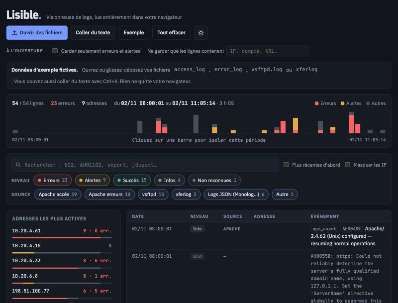
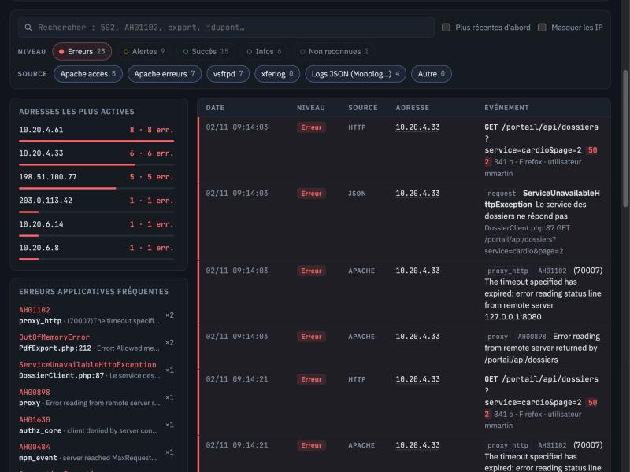

# Lisible
 
**Des logs serveur qu'on lit d'un coup d'œil.**
 
🌐 **[lisible.net](https://lisible.net)** · rien à installer · aucune donnée envoyée
 

 
---
 
## Le problème
 
Des logs serveur bruts : des milliers de lignes serrées, sans couleur et sans structure, souvent réparties sur plusieurs fichiers.
Trouver d'où vient une erreur prend du temps, alors que c'est justement là qu'on a besoin d'aller vite.
 
## La solution
 
Lisible reconnaît automatiquement le format de chaque ligne, sépare les champs (date, niveau, module, code, adresse…) et permet d'isoler en quelques clics ce qui s'est passé.
 

 
## Fonctionnalités
 
- 🧩 **Détection automatique du format** : plusieurs fichiers ouverts d'un coup (y compris en `.gz`), fusionnés et triés par date
- 📊 **Frise des erreurs** : un histogramme des erreurs et alertes dans le temps ; un clic sur une barre isole la période
- 🔍 **Filtres** par niveau, source et texte ; un clic sur une adresse IP montre toute son activité, tous fichiers confondus
- 📋 **Synthèse automatique** : adresses les plus actives, URL en erreur, échecs de connexion FTP par adresse (pour repérer une attaque par force brute)
- 🪜 **Stack traces regroupées** : les lignes de suite d'une erreur PHP sont rattachées à leur entrée, avec la ligne brute à copier dans un ticket
- 🙈 **« Masquer les IP »** : tronque les adresses à l'écran et dans les copies, pour partager une capture sans exposer le réseau
- 🌗 **Thème clair / sombre**
  

 
## Formats pris en charge
 
| Format | Fichier habituel | Ce qui est extrait |
|---|---|---|
| Apache accès (common, combined) | `access_log` | Méthode, URL, code HTTP, taille, navigateur, utilisateur, page d'origine |
| Apache erreurs (2.2 et 2.4) | `error_log` | Module, gravité, code `AHxxxxx`, client, processus, message |
| vsftpd | `vsftpd.log` | Connexions réussies ou échouées, compte, envois, téléchargements, débit |
| xferlog | `xferlog` | Sens du transfert, fichier, taille, durée, compte, transfert complet ou non |
| Logs JSON : Monolog (Symfony, Laravel), pino, logstash | `prod.log`, `*.json` | Niveau, canal, message, exception, fichier et ligne, trace ; heure convertie dans le fuseau local |
 
Les lignes d'un format inconnu restent affichées telles quelles, dans « Non reconnues ».
 
## Confidentialité
 
Les logs contiennent des adresses, des comptes et parfois des données sensibles. Lisible a donc été conçu pour **ne rien envoyer** :
 
- **Lecture locale** : les fichiers sont analysés par le navigateur, il n'y a aucun serveur d'analyse
- **Aucun traceur** : pas de cookies, pas de statistiques de visite, pas de publicité
- **Bloqué par le navigateur** : une politique de sécurité (CSP) interdit toute connexion réseau depuis la page
- **Vérifiable** : ouvrez l'onglet Réseau des outils de développement et chargez un fichier, aucune requête ne part
## Performances
 
L'analyse tourne en arrière-plan et lit le fichier par morceaux : l'interface reste fluide, avec une barre de progression et un bouton pour annuler. **Un fichier de 117 Mo (un million de lignes) est analysé en quelques secondes.**
 
Pour les très gros fichiers, un filtre appliqué à l'ouverture (erreurs seulement ou mot-clé) écarte le reste pendant la lecture, ce qui économise la mémoire.
 
## Stack technique
 
- **HTML, CSS et JavaScript natifs**, sans framework
- **Web Worker** pour analyser en arrière-plan, avec une lecture du fichier par morceaux
- **Content Security Policy** stricte, qui interdit toute requête sortante
- **Hébergement** : site statique
  
## Choix techniques
 
- **Tout se passe côté client** : c'est ce qui garantit la confidentialité, sans dépendre de la confiance qu'on accorde au serveur
- **Un parseur par format** : on peut ajouter un format sans toucher aux autres, et une ligne inconnue n'est jamais perdue
- **Lecture en streaming dans un Worker** : on traite des fichiers de plusieurs centaines de Mo sans figer l'interface
  
## Feuille de route
 
- [x] V1 : formats Apache, vsftpd, xferlog et JSON, frise, filtres, synthèse, mise en ligne
- [ ] V2 : couvrir le plus de formats de logs possible (Nginx, syslog, formats Apache personnalisés…)
 
